 

Games and tools in progress at **Summit Tec**, our studio.

<table>
<tr>
<td width="50%" valign="top">

### Monarchy

`UNITY 6` `URP` `LOW-POLY` `KINGDOM BUILDER`

A persistent living kingdom: build settlements, govern a realm, and command armies of individually animated low-poly soldiers in one continuous world.

Latest major game · working title

</td>
<td width="50%" valign="top">

### New Roots

`UNITY 6` `SURVIVAL` `LOCAL CO-OP`

Make a home after a shipwreck. Explore a tropical island, forage and grow food, cook, craft tools, and build a campsite, alone or with a friend.

Latest major game · in development

</td>
</tr>
<tr>
<td width="50%" valign="top">

### AIA

`UNITY 6` `URP` `LOW-POLY 3D`

*Administrative Intelligence Agency*: an intelligence-agency management sim set in **2054**. As the Director, command agents, facilities, and diplomacy across a living world that keeps acting and reacting.

</td>
<td width="50%" valign="top">

### AIA-Evolve

`CLAUDE CODE` `GITHUB ACTIONS`

An autonomous AI agent that evolves AIA **around the clock**: reading the backlog, writing C#, validating, committing, and documenting its work without human intervention.

</td>
</tr>
<tr>
<td colspan="2" valign="top">

### [HomeLife App](https://github.com/Lasutriv/HomeLifePublic)

`DOCKER`

A fully dockerized home management app.

</td>
</tr>
</table>

> [!TIP]
> **AIA is being built alongside an AI agent.** AIA-Evolve runs on GitHub Actions, picking up backlog issues, implementing the changes, and closing them out, many times a day.

 

 

<picture>
  <source media="(prefers-color-scheme: dark)" srcset="https://raw.githubusercontent.com/Lasutriv/Lasutriv/output/snake-dark.svg" />
  
</picture>

*Stats and top languages don't count private repositories or every project I've worked on.*

 

https://github.com/Lasutriv/Lasutriv/assets/4943212/94c30bb3-68fa-4a73-a01d-20fc29d1e0cf

 

Ask me about **autonomous AI agents in game dev**, **3D low-poly games**, or **dockerized home automation**. 
Reach me by [email](mailto:tannerf1101@yahoo.com).

